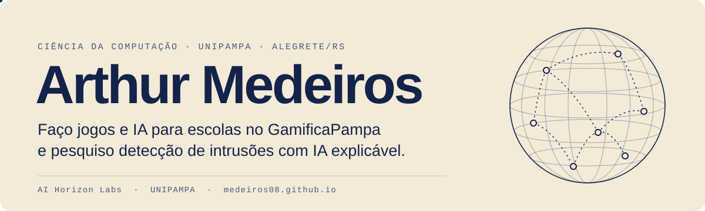
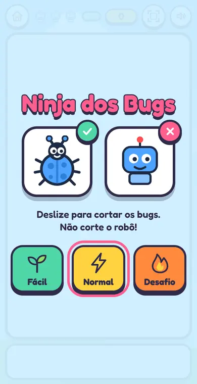
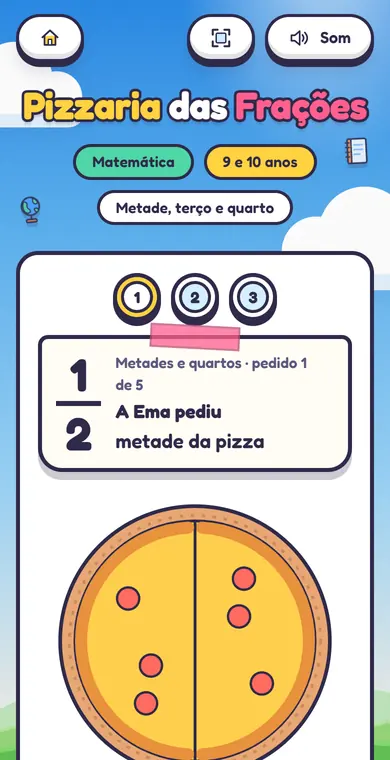
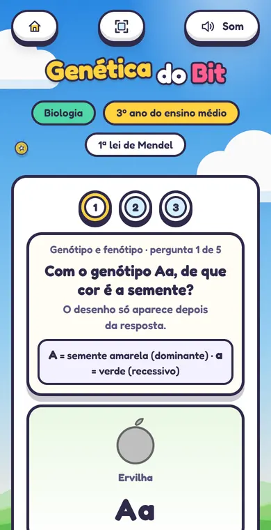
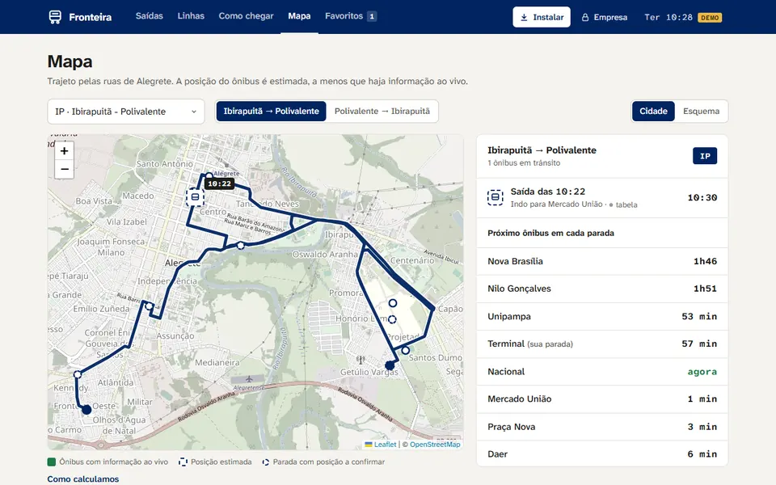

<a href="https://medeiros08.github.io">
  <picture>
    <source media="(prefers-color-scheme: dark)" srcset="assets/banner-escuro.svg"/>
    
  </picture>
</a>

  <a href="https://arthurmedeiros.dev"><b>Portfólio</b></a> &nbsp;·&nbsp;
  <a href="https://arthurmedeiros.dev/notas/ia-explicavel/">IA explicável, sem jargão</a> &nbsp;·&nbsp;
  <a href="https://www.linkedin.com/in/arthur-medeiros-34a344356/">LinkedIn</a> &nbsp;·&nbsp;
  <a href="http://lattes.cnpq.br/3699255553076395">Lattes</a> &nbsp;·&nbsp;
  <a href="https://orcid.org/0009-0000-8991-4068">ORCID</a> &nbsp;·&nbsp;
  <a href="https://www.instagram.com/medeiros__08/">Instagram</a> &nbsp;·&nbsp;
  <a href="mailto:arthurfreitas.aluno@unipampa.edu.br">E-mail</a>

 

Estudo Ciência da Computação na UNIPAMPA, em Alegrete, e a maior parte do meu tempo vai para o **GamificaPampa**: faço os jogos que as crianças abrem pelo celular na sala de aula e as ferramentas que ajudam professores de escolas públicas a criar materiais com IA.

Também sou bolsista de pesquisa no **XAIID**, projeto da UNIPAMPA coordenado pelo professor Silvio E. Quincozes: uso aprendizado de máquina para detectar ataques em sistemas ciber-físicos e IA explicável para entender por que o modelo decidiu cada coisa. Faço parte do **AI Horizon Labs**, o laboratório de IA e engenharia de software da universidade. Aprendo melhor testando e colocando a mão na massa.

 

## Agora

| Desenvolvendo | Pesquisa | Grupo |
|:--|:--|:--|
| **GamificaPampa**: jogos e IA para escolas públicas · **Expresso Gaúcho**: ônibus de Alegrete em tempo real | **XAIID**: bolsista desde nov/2026, detecção de intrusões em sistemas ciber-físicos com aprendizado de máquina e IA explicável | **AI Horizon Labs**: laboratório de IA e Engenharia de Software da UNIPAMPA |

 

## GamificaPampa

Hub de extensão da UNIPAMPA que leva IA e gamificação a professores de escolas públicas de Alegrete. Fiz **30 dos 31 jogos** (6 de programação e 24 por matéria, da Educação Infantil ao ensino médio), as aulas de 50 minutos sobre programação e sobre IA, a **Oficina de Prompts** e a **Máquina de prompts**.

<table>
  <tr>
    <td width="33%"> <b>Ninja dos Bugs</b> · programação</td>
    <td width="33%"> <b>Pizzaria das Frações</b> · matemática</td>
    <td width="33%"> <b>Genética do Bit</b> · biologia</td>
  </tr>
</table>

<a href="https://gamificapampa.github.io"><b>Abrir o hub ↗</b></a> &nbsp;·&nbsp; <a href="https://medeiros08.github.io/projetos/gamificapampa/">Estudo de caso</a> &nbsp;·&nbsp; <a href="https://github.com/GamificaPampa">Organização no GitHub</a>

HTML · CSS · JavaScript. A identidade visual e o jogo Robô pega a estrela são de Paulo Severo.

 

## Outros projetos

<table>
  <tr>
    <td width="50%" valign="top">
      
      <h3><a href="https://github.com/medeiros08/expresso-gaucho">Expresso Gaúcho</a></h3>
      Linhas, horários e ônibus em tempo real para Alegrete, com os horários reais de 9 linhas, mapa da cidade e alertas. Instala no celular e funciona sem internet.
        
      JavaScript · PWA · Leaflet
    </td>
    <td width="50%" valign="top">
      <h3>XAIID</h3>
      <i>Estratégias Inteligentes e Explicáveis para Detecção de Intrusões em Sistemas Ciber-Físicos</i>. Bolsa de pesquisa desde novembro de 2026: quais características do tráfego mais ajudam a reconhecer cada tipo de ataque, e por quê.
        
      Python · scikit-learn · IA explicável · <a href="https://arthurmedeiros.dev/notas/ia-explicavel/">nota sobre IA explicável</a>
      <h3><a href="https://github.com/medeiros08/Snort-p4">Snort-p4</a> (trabalho anterior)</h3>
      Compila cabeçalhos de regras do Snort 3 em pré-filtros P4 conservadores, avaliados no BMv2: artigo, compilador, programa P4 e artefatos experimentais.
        
      P4 · Python · BMv2
    </td>
  </tr>
</table>

 

## Ferramentas

  
  
  
  
  
  
  
  

 

<!-- Snake: gerado por .github/workflows/snake.yml no branch "output" -->
<picture>
  <source media="(prefers-color-scheme: dark)" srcset="https://raw.githubusercontent.com/medeiros08/medeiros08/output/github-snake-dark.svg"/>
  
</picture>

Fora do teclado: música, esporte e viagens.

